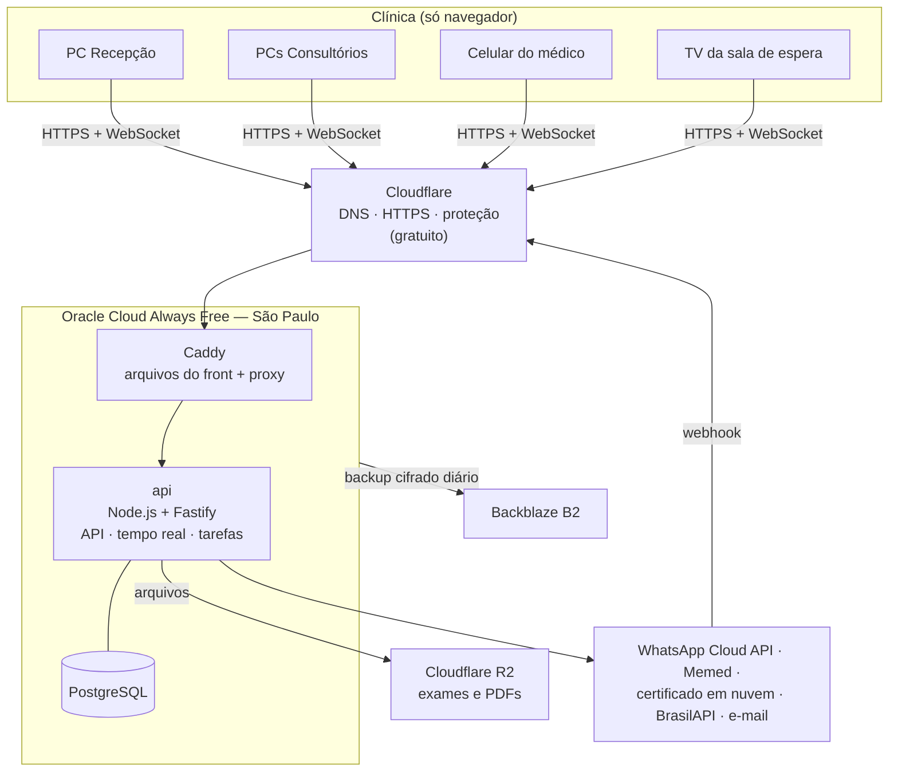

# Arquitetura — sis_Clinicas

> Versão 0.2 — 04/11/2026 — sistema web, JavaScript, custo mínimo
>
> Substitui a v0.1 (app desktop com servidor local). Motivo: os primeiros clientes não querem manter servidor dentro da clínica.

## 1. Decisões

| # | Decisão | Motivo |
|---|---|---|
| A1 | **Sistema web**: a clínica só precisa de navegador e internet | Nada para instalar nem manter na clínica; o médico acessa de casa ou do celular |
| A2 | **JavaScript** (não TypeScript) no front e no back, com módulos ES | Uma linguagem só, sem etapa de compilação no servidor. A segurança de tipos vem de validação com Zod, testes e JSDoc opcional (§10.1) |
| A3 | Front em **React + Vite** (SPA), **sem Next.js** | Todo o sistema fica atrás de login, então a renderização no servidor do Next não traz ganho; o Vite gera arquivos estáticos simples de hospedar |
| A4 | Back em **Node.js LTS + Fastify** | Leve, rápido, validação e logs embutidos, funciona bem em JS puro (o NestJS depende de decorators do TypeScript) |
| A5 | Banco **PostgreSQL** (não MongoDB) | Ver §3.3: dinheiro com transações, bloqueio de horário duplicado no próprio banco, prontuário imutável, separação por clínica |
| A6 | **Sem Redis**: filas e tarefas agendadas no próprio PostgreSQL (pg-boss) | Um serviço a menos para pagar e manter |
| A7 | **Multi-clínica desde o início** (`clinica_id` + Row-Level Security) | Agora o sistema roda num servidor nosso: a 2ª clínica entra sem nova instalação |
| A8 | Hospedagem no **Oracle Cloud Always Free, região São Paulo**, com **Docker Compose** | Gratuito, com folga para várias clínicas; dados no Brasil; Docker permite mudar de provedor em uma hora (§4) |
| A9 | **Cloudflare (plano gratuito)** na frente: DNS, HTTPS, proteção contra ataques | Gratuito |
| A10 | Backup criptografado num **provedor diferente** do servidor (Backblaze B2) | Se a conta da Oracle tiver problema, os dados estão em outro lugar |
| A11 | **WhatsApp oficial (Cloud API da Meta)**; começar com links `wa.me` gratuitos | APIs não oficiais violam os termos do WhatsApp e podem bloquear o número da clínica |
| A12 | Pode ser **instalado como app** no PC (PWA): ícone na área de trabalho, janela própria, notificações | Mesma experiência de "programa instalado" sem instalador, sem custo |

**Muda em relação ao `mvp.md`:** a D6 volta a ser **web primeiro** (sem app desktop), e a D7 volta a ser **online obrigatório**, com contingência (§6).

## 2. Visão geral



- A clínica abre `app.sisclinicas.com.br` no navegador (ou no ícone instalado). Não há servidor na clínica.
- Um único servidor atende todas as clínicas. Cada registro tem `clinica_id`, e o banco impede que uma clínica veja dados de outra (RLS).
- O WhatsApp chega direto no servidor, que já é público. Não precisa mais de túnel.

## 3. Componentes

### 3.1 Front (`apps/web`)

| Item | Escolha |
|---|---|
| Base | React + Vite, JavaScript (JSX) |
| Telas e componentes | Mantine (licença MIT; formulários, datas, avisos e tema claro/escuro prontos), com o visual simples já validado nos simuladores: botões grandes e poucos campos por tela |
| Rotas e dados | React Router + TanStack Query (cache, recarregar ao voltar para a aba) |
| Formulários | Mantine Form + os mesmos esquemas Zod do servidor |
| Agenda | **componente próprio**, igual à grade dos simuladores. Evita os plugins pagos do FullCalendar (a visão por profissional é paga) |
| Tempo real | Socket.IO client: agenda, chegada de paciente, inbox, painel da TV |
| Impressão | página de impressão com CSS próprio (recibo, receita, atestado) e `window.print()` |
| PWA | `vite-plugin-pwa`: instalar como app, notificações, agenda do dia em cache para contingência (§6) |

### 3.2 Back (`apps/api`)

| Item | Escolha |
|---|---|
| Base | Node.js LTS + Fastify, JavaScript com módulos ES |
| Banco | **postgres.js** com SQL escrito à mão; migrações em SQL puro com `node-pg-migrate`. Sem ORM: as regras mais importantes (constraints, triggers, RLS) já são SQL |
| Validação | Zod, com os esquemas em `packages/shared` usados também no front |
| Login | sessão no servidor (tabela `sessao`) com cookie `httpOnly` + `Secure` + `SameSite=Strict`; senha com Argon2id (`@node-rs/argon2`); verificação em duas etapas TOTP (`otplib`), **obrigatória para todos**, porque o sistema agora está na internet |
| Proteção | `@fastify/rate-limit` (tentativas de login), `@fastify/helmet` (cabeçalhos), CSRF por `SameSite` + checagem de origem |
| Tempo real | Socket.IO. Com mais de uma instância, o adaptador oficial para PostgreSQL, ainda sem Redis |
| Tarefas e filas | pg-boss: lembretes, envio de WhatsApp com novas tentativas, expiração de sessões, relatórios agendados |
| PDF | pdfmake (gera no servidor, sem navegador embutido) |
| Assinatura de PDF | `@signpdf` para PAdES com **certificado em nuvem** (§5) |
| Logs | pino (já vem no Fastify), sem dados pessoais |

### 3.3 Banco de dados: PostgreSQL, não MongoDB

| Necessidade do sistema | PostgreSQL | MongoDB |
|---|---|---|
| Impedir dois pacientes no mesmo horário, garantido pelo banco | `EXCLUDE USING gist` (já desenhado no `mvp.md` §5.5) | não tem equivalente; só checando no código, sujeito a corrida entre duas recepcionistas |
| Dinheiro: pagamento, estorno e caixa sempre consistentes | transações ACID maduras | tem transações, mas o modelo de documentos não ajuda |
| Prontuário assinado imutável | trigger que bloqueia alteração e exclusão | não tem triggers no servidor comunitário |
| Separar clínicas no mesmo servidor | Row-Level Security: o banco filtra por `clinica_id` mesmo se o código esquecer | só no código |
| Relatórios (faturamento, faltas, ocupação) | SQL com junções | agregações mais trabalhosas |
| Campos flexíveis (modelos de prontuário por especialidade) | `jsonb` resolve | ponto forte do MongoDB, mas o `jsonb` cobre |
| Licença | PostgreSQL License (livre, inclusive para vender como SaaS) | SSPL, que restringe oferecer o banco como serviço |

Extensões, todas gratuitas: `btree_gist`, `pg_trgm` (busca de pacientes tolerante a erros de digitação), `unaccent`, `pgcrypto`.

**RLS na prática:** a API abre cada requisição com `SET LOCAL app.clinica_id = ...` dentro de uma transação, e todas as tabelas têm a política `clinica_id = current_setting('app.clinica_id')::uuid`. O usuário do banco usado pela API não é dono das tabelas, então não consegue desligar a regra.

### 3.4 Arquivos

Exames, imagens e PDFs assinados ficam no **Cloudflare R2** (compatível com S3, 10 GB grátis, sem cobrança de download), num bucket privado, separados por clínica e paciente. O hash SHA-256 de cada arquivo fica no banco. Para abrir um arquivo, a API confere a permissão, registra a leitura na auditoria e devolve um link temporário de 5 minutos.

### 3.5 Painel da TV

Página `/painel/<código>` aberta em qualquer TV com navegador, Chromecast ou PC velho ligado na TV. Usa um código por sala, sem login de usuário, e só mostra o primeiro nome e a sala.

## 4. Hospedagem

### 4.1 Recomendação: Oracle Cloud Always Free

| Recurso gratuito (sempre) | Uso |
|---|---|
| VM ARM (Ampere) com até 4 núcleos e 24 GB de RAM | uma VM com tudo: Caddy, API e PostgreSQL. Atende várias clínicas |
| 200 GB de disco | banco e cópias locais do backup |
| 10 TB de tráfego de saída por mês | muito acima do necessário |
| Região **São Paulo** | dados no Brasil, menor atraso |

Cuidados:
- A região escolhida no cadastro é a única com recursos gratuitos: **escolher São Paulo** ao criar a conta. Às vezes falta VM ARM disponível; é só tentar de novo mais tarde.
- Pedem cartão de crédito para verificação. Recomendo **passar a conta para "Pay As You Go"**. Continua sem custo dentro dos limites gratuitos, mas a Oracle não recupera VMs paradas e a conta fica mais estável. Configurar um **alerta de orçamento de R$ 1** para avisar de qualquer cobrança.
- Confirmar os limites atuais na página do Always Free antes de contratar.

### 4.2 Como roda

```
VM (Ubuntu Server LTS)
└─ docker compose
   ├─ caddy      # HTTPS, arquivos do front (build do Vite), proxy para a api
   ├─ api        # Node.js + Fastify + Socket.IO + pg-boss
   ├─ postgres   # PostgreSQL 17, volume no disco da VM
   └─ backup     # restic + pg_dump, agendado
```

- Tudo é descrito em `infra/docker-compose.yml`. Para trocar de provedor, basta criar outra VM, rodar o compose e restaurar o backup.
- Firewall da VM: só as portas 80/443, e só para os IPs da Cloudflare. SSH só por chave.
- Atualizações automáticas de segurança do Ubuntu ligadas.

### 4.3 Plano B (se a Oracle não servir)

| Opção | Custo | Quando |
|---|---|---|
| VPS barata no Brasil (ex.: AWS Lightsail São Paulo, Magalu Cloud) | ≈ US$ 5–10/mês (pesquisar preço atual) | não conseguir VM gratuita ou querer suporte |
| Banco gerenciado gratuito (Neon, Supabase) | grátis com limites (≈ 0,5 GB) e pausa por inatividade | **só para desenvolvimento e demonstração**, não para dados reais |

### 4.4 Ambientes

| Ambiente | Onde | Custo |
|---|---|---|
| Desenvolvimento | PC do dev: Node.js + PostgreSQL (instalado ou Docker) | R$ 0 |
| Homologação | segundo compose na mesma VM, com banco separado e dados fictícios | R$ 0 |
| Produção | VM Oracle | R$ 0 |

## 5. Integrações externas

| Integração | Para quê | Custo | Alternativa gratuita / observação |
|---|---|---|---|
| **WhatsApp Cloud API (Meta)** | lembretes, confirmações, inbox | responder o paciente dentro de 24 h da mensagem dele é gratuito; mensagens de modelo (lembretes) são cobradas por mensagem, em centavos (confirmar a tabela atual da Meta para o Brasil) | **Fase 0:** o sistema monta o texto e abre o link `wa.me` no WhatsApp da recepção; ela só toca em enviar. Gratuito e dentro das regras, mas sem inbox integrada nem confirmação automática |
| WhatsApp não oficial (Baileys, whatsapp-web.js) | — | gratuito | **Não usar:** viola os termos do WhatsApp, pode bloquear o número da clínica e é arriscado para dados de saúde |
| **Certificado em nuvem do médico** (BirdID, VIDaaS e outros) | assinar consultas, receitas e atestados | o certificado é do médico; o uso da API pelo integrador costuma ser gratuito (confirmar com cada provedor) | **Token A3 fica fora do MVP:** o navegador não acessa o token sozinho; exigiria um pequeno programa local, ou um componente pago como o Web PKI. Fase posterior, se algum médico só tiver A3 |
| **Memed** | prescrição com base de remédios | gratuita para o médico; a integração exige cadastro como parceiro | receita simples por modelo do próprio sistema (já no MVP) |
| **BrasilAPI / ViaCEP** | CEP, CNPJ, feriados nacionais | gratuitas | — |
| **CID-10** | busca de diagnóstico | tabela pública do DATASUS, importada no banco | — |
| **PIX** | QR Code no pagamento | **QR Code estático com valor (padrão BR Code) gerado pelo próprio sistema: gratuito**, conferência manual no extrato | QR dinâmico com baixa automática exige a API de um banco ou intermediador, que costuma cobrar por transação. Fase posterior |
| **E-mail** | convites, nova senha, cópia de dados (LGPD) | Brevo: 300 e-mails/dia no plano grátis | — |
| **Cloudflare R2** | arquivos | 10 GB grátis; depois, centavos de dólar por GB | — |
| **Backblaze B2** | backup | 10 GB grátis | — |
| **UptimeRobot** | avisar se o sistema cair | plano grátis (checagem a cada 5 min) | — |
| **Sentry** | erros do front e da API | plano grátis para desenvolvedor | configurar para **não enviar dados pessoais** |
| NFS-e | nota fiscal | o webservice da prefeitura costuma ser gratuito, com certificado A1 da clínica | fase posterior |

## 6. Sem internet na clínica

Agora o sistema depende da internet da clínica.

| Medida | Custo |
|---|---|
| **Segunda conexão:** roteador 4G barato ou um celular roteando, ligado só quando a principal cai | chip pré-pago |
| **Agenda do dia em cache (PWA):** se a conexão cair, a recepção ainda vê quem vem hoje, em modo somente leitura, com aviso de "sem conexão". O cache é apagado ao sair do sistema | R$ 0 |
| **Imprimir a agenda do dia** (botão na agenda), para quem preferir papel | R$ 0 |
| Atendimento sem conexão: anotar no papel e lançar depois. Agendar e cobrar offline exigiria sincronização com conflitos, o que não vale a complexidade no MVP | — |

Se o **servidor** cair, o UptimeRobot avisa por e-mail e Telegram. O sistema volta com `docker compose up` ou, no pior caso, restaurando o backup em outra VM (§7).

## 7. Backup e recuperação

| O quê | Como | Onde |
|---|---|---|
| Banco | `pg_dump` a cada 6 horas e arquivamento contínuo do WAL (permite voltar a qualquer minuto) | disco da VM |
| Banco | **restic** (gratuito): criptografado antes de sair da VM, só envia o que mudou, guarda 30 cópias diárias e 12 mensais | **Backblaze B2**, em outro provedor |
| Arquivos | versionamento do bucket R2 + cópia semanal via restic | R2 e B2 |
| Senha do backup | guardada fora do servidor (cofre de senhas do responsável + cópia impressa) | sem ela não há como ler o backup |
| Teste | restauração automática mensal num banco temporário, com o resultado enviado por e-mail | — |

Meta: perder no máximo **minutos** de dados, e voltar ao ar em **até 2 horas** numa VM nova.

## 8. Segurança e LGPD

- **Papéis na LGPD:** a clínica é a **controladora**, e nós (fornecedor do sistema) somos **operadores**. Precisamos de um contrato com cada clínica (termo de tratamento de dados). Oracle, Cloudflare e Backblaze são suboperadores e devem ser listados nesse termo.
- Dados no Brasil (Oracle São Paulo). O backup em B2 fica fora do país, mas criptografado antes de sair, com a chave só conosco; mesmo assim, citar no termo.
- Disco da VM criptografado (padrão na Oracle), backup criptografado (restic), HTTPS em todo o caminho (Cloudflare → Caddy com certificado de origem).
- Verificação em duas etapas obrigatória; bloqueio após erros; sessão expira por inatividade; o admin da clínica pode encerrar sessões de qualquer usuário.
- Permissões checadas na API, nunca só na tela. RLS no banco como segunda barreira entre clínicas.
- `audit_log` só aceita inclusão (o usuário do banco da API não pode alterar nem apagar), inclusive leituras de prontuário.
- Prontuário assinado bloqueado por trigger; correções só por adendo.
- Logs e Sentry sem dados pessoais.
- Acesso administrativo à VM só por SSH com chave e, no futuro, pelo Cloudflare Access (gratuito até 50 usuários).

## 9. Entrega contínua

- **GitHub** (repositório privado, gratuito) + **GitHub Actions** (2.000 minutos/mês grátis para repositório privado): lint, testes com PostgreSQL real e build a cada mudança.
- Deploy: ao criar uma versão (tag), o Actions gera a imagem Docker, envia ao GitHub Container Registry e, por SSH, roda na VM: **backup → migrações → `docker compose up -d`**.
- O front é versionado junto. Ao publicar, quem está com o sistema aberto vê "Nova versão disponível, clique para atualizar".
- Sem instalador nem assinatura de código: o custo de distribuição desaparece.

## 10. Desenvolvimento (tudo gratuito)

### 10.1 JavaScript sem TypeScript: como manter a segurança

| Risco do JS puro | Como cobrir |
|---|---|
| Dados errados chegando na API | Zod valida toda entrada da API; os mesmos esquemas validam os formulários |
| Erro bobo de nome ou tipo | ESLint + Prettier; `// @ts-check` com JSDoc nos arquivos de regra de negócio, se a equipe quiser (o VS Code checa sem compilar nada) |
| Regras críticas quebrando | testes automatizados obrigatórios em agenda, estados do atendimento, dinheiro e prontuário |
| Banco aceitar algo inválido | constraints, triggers e RLS no PostgreSQL: a última barreira não depende do JS |

### 10.2 Ferramentas

| Ferramenta | Uso |
|---|---|
| VS Code, Git, GitHub | código e versões |
| Node.js LTS + **npm workspaces** | monorepo, sem ferramenta extra |
| PostgreSQL (instalado ou Docker Desktop, gratuito para empresas pequenas) | banco local |
| Vitest | testes de unidade e de API (com banco real de teste) |
| Playwright | testes ponta a ponta dos fluxos principais |
| ESLint + Prettier | padrão de código |

### 10.3 Estrutura do repositório

```
sis_Clinicas/
├─ apps/
│  ├─ web/            # React + Vite (JSX), PWA
│  │  └─ src/telas/   # inicio, agenda, recepcao, consulta, whatsapp, pagamentos,
│  │                  # pacientes, recados, relatorios, administracao, painel-tv
│  └─ api/            # Fastify
│     └─ src/modulos/ # auth, clinica, pacientes, profissionais, agenda, recepcao,
│                     # prontuario, assinatura, financeiro, chat, inbox, mensageria,
│                     # relatorios, auditoria
├─ packages/
│  └─ shared/         # esquemas Zod, status, regras puras (dinheiro em centavos, horários)
├─ db/
│  ├─ migrations/     # SQL: tabelas, constraints, triggers, RLS
│  └─ seed/           # CID-10, clínica e usuários de exemplo
├─ infra/
│  ├─ docker-compose.yml
│  ├─ Caddyfile
│  └─ backup/         # scripts restic e pg_dump
└─ docs/
```

## 11. Custos

| Item | Quando | Custo |
|---|---|---|
| Ferramentas e bibliotecas | sempre | **R$ 0** (todas de código aberto) |
| Servidor (Oracle Always Free) | por mês | **R$ 0** |
| Cloudflare, R2 até 10 GB, B2 até 10 GB, Brevo, UptimeRobot, Sentry, GitHub | por mês | **R$ 0** nos planos gratuitos |
| Domínio do produto (ex.: `sisclinicas.com.br`) | por ano | ≈ R$ 40 |
| WhatsApp: lembretes automáticos (Cloud API) | por mês | por mensagem de modelo enviada; responder o paciente em até 24 h é gratuito. **Fase 0 com `wa.me`: R$ 0** |
| Certificado digital | — | do médico |
| Na clínica | uma vez | **R$ 0** (usa os PCs e a internet que já existem); roteador 4G de reserva opcional |

Comparado à v0.1, sai o mini PC e o nobreak da clínica e o certificado de assinatura do instalador.

## 12. Evolução

| Fase | O que muda | Custo extra |
|---|---|---|
| 1 clínica | VM gratuita única | ≈ R$ 40/ano |
| 2 a ~20 clínicas | mesma VM; cada clínica é um registro novo (já multi-clínica) | R$ 0 enquanto couber na VM gratuita (acompanhar uso de CPU, RAM e disco) |
| Crescimento | banco gerenciado ou VM paga maior; API em mais de uma instância (Socket.IO com adaptador PostgreSQL) | conforme o número de clínicas, coberto pela mensalidade |
| App de celular | a própria PWA instalada no celular; app nativo só se houver necessidade real | R$ 0 |
| Token A3 | pequeno programa local para assinar com o token | fase posterior |

## 13. Riscos

| Risco | Como reduzir |
|---|---|
| Oracle encerrar a conta gratuita ou mudar as regras | conta Pay As You Go, backup em outro provedor, infraestrutura em Docker Compose para subir em outra VM em até 2 horas |
| Internet da clínica cair | segunda conexão 4G, agenda do dia em cache, agenda impressa |
| Invasão (o sistema agora está na internet) | duas etapas obrigatória, limite de tentativas, Cloudflare na frente, firewall só para a Cloudflare, atualizações automáticas, RLS e auditoria |
| Erro de tipo por usar JS puro | Zod, testes nas regras críticas, constraints no banco (§10.1) |
| Custo do WhatsApp crescer | começar com `wa.me`; usar a API só para lembretes que reduzem faltas e mostrar o custo nos relatórios |
| Mudança de preço ou regra das APIs gratuitas | cada integração isolada num módulo próprio, fácil de trocar |
| Atualização quebrar o banco | backup automático antes de todo deploy e migrações testadas no GitHub Actions |

## 14. Pontos em aberto

1. Nome e domínio do produto (ex.: `sisclinicas.com.br`)?
2. Criar a conta na Oracle Cloud (São Paulo) agora ou começar só com o ambiente local?
3. Começar o WhatsApp pela Fase 0 (`wa.me`, gratuita) ou já contratar a Cloud API?
4. Algum médico só tem **token A3** (sem certificado em nuvem)? Isso define se o A3 entra antes.
5. A internet da clínica é estável? Vale indicar o 4G de reserva desde o início?
